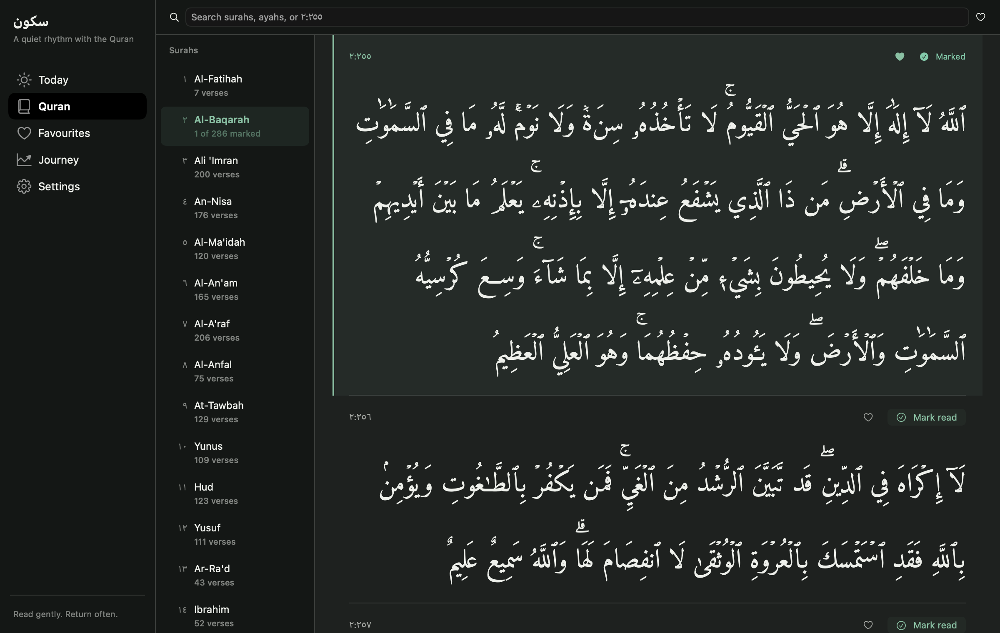
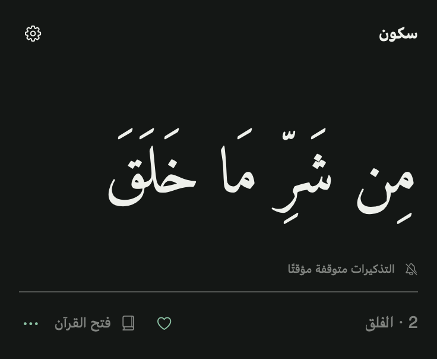
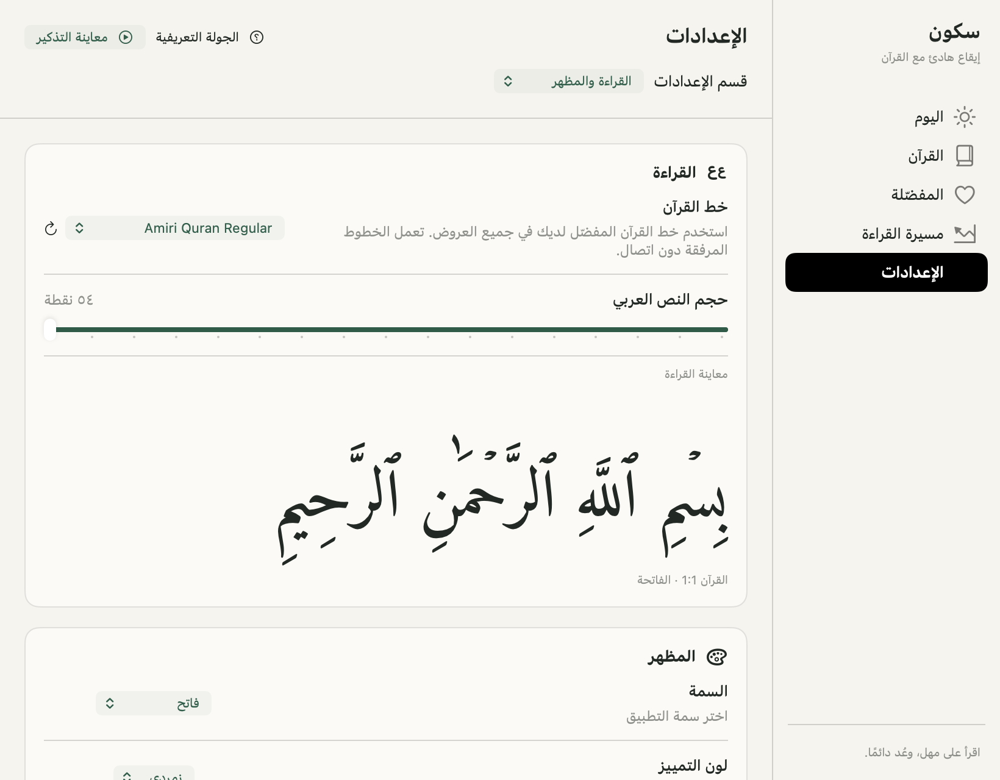
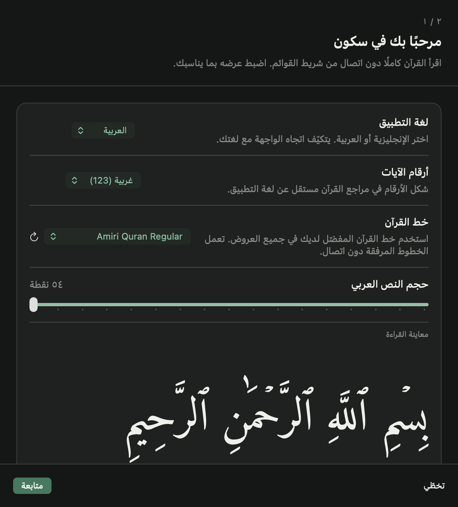

<p align="center">
  
</p>

<h1 align="center">Sukoon · سكون</h1>

<p align="center">
  <strong>A quiet rhythm with the Quran.</strong><br>
  A native macOS menu bar app for Arabic ayahs, Quranic duas, and a reading journey that remembers where you stopped.
</p>

<p align="center">
  
  
  
  
</p>

<p align="center">
  <a href="#preview">Preview</a> ·
  <a href="#getting-started">Getting started</a> ·
  <a href="#reading-modes">Reading modes</a> ·
  <a href="#development">Development</a> ·
  <a href="#quran-sources-and-licensing">Sources &amp; licensing</a>
</p>

---

## Preview

<p align="center">
  
</p>

The Quran stays primary. Search and favourites open exact ayahs; compact navigation replaces sidebars when space is limited without losing the reading position.

<details>
<summary><strong>Menu bar, Arabic settings, and welcome tour</strong></summary>

<p align="center">
  
</p>

<p align="center">
  
</p>

<p align="center">
  
</p>

</details>

<sub>Actual app-local native-view captures on macOS 27 with isolated demonstration preferences, not mockups. WindowServer compositing and title bars are not captured. See the <a href="docs/design-verification.md">before/after gallery, exercised scenarios, and verification limits</a>.</sub>

## Features

- **Small, timed reading moments.** A reminder every two minutes by default, configurable from 30 seconds to two hours, with pause/resume, local quiet hours, and temporary snooze controls.
- **The complete Quran, offline.** All 114 surahs and 6,236 ayahs in Arabic Uthmani text. Search chapter names/numbers or Arabic ayah text without typing its vocalization; direct references such as `2:255` also accept Arabic digits.
- **Automatic Quran reading.** Move from Al-Fatihah to An-Nas, one ayah at a time, with a separately saved position.
- **Choose your own surah.** Follow a chapter, then continue automatically to the next unread surah without resetting the automatic Quran journey.
- **Favourites, one tap away.** Use the small heart in the reader, menu bar, or reminder panel. A dedicated Favourites collection opens the exact saved ayah.
- **English and Arabic.** An immediately switchable interface with right-to-left layout in Arabic and independently selectable Quran digits.
- **Compact, adjustable appearance.** Opaque ivory/stone and dark reading surfaces, restrained accents, a resizable workspace and reminder panel, System/Light/Dark themes, Jade/Gold/Rose choices, and adjustable Arabic fonts and text size.
- **Offline mushaf fonts.** Six licensed fonts are bundled, alongside compatible Arabic fonts already installed on the Mac.
- **Uninterrupted completion.** A short success toast confirms a finished surah without opening the main window or asking for confirmation. Full Quran completion retains a quiet completion sheet and the complete Quranic dua, without decorative animation.
- **Native startup control.** An OS-backed **Run at startup** switch with explicit approval/error feedback.
- **Updates on request.** Check the public GitHub release only when you press **Check for updates**.
- **Portable reading backup.** Export/import versioned JSON without replacing language, appearance, or reminder preferences.
- **A short welcome tour.** Two steps with independent language/digit choices, real font and reminder previews, and separate interval/display-duration explanations. Replay it from Settings; existing users keep their preferences and are not forced through it.

## Getting started

### Requirements

- **Prebuilt app:** an **Apple Silicon Mac (M1 or later)** running **macOS 26 or later**. The release ZIP does not support Intel Macs.
- **Building from source:** macOS 26 or later, a full **Xcode** installation with **Swift 6.2 or later**, and a compatible macOS SDK. Command Line Tools alone are not sufficient for building this project.

Verified configuration: **macOS 27, Apple Silicon, Xcode 27, Swift 6.4**. Other configurations have not been verified.

### Download and install

Download **[Sukoon 1.3.0](https://github.com/rayenfassatoui/Sukoon/releases/tag/v1.3.0)** for the quiet reading redesign, two-step welcome tour, and reader/layout improvements shown here. Choose the app ZIP attached to the release; the source-code archives are for building from source.

1. Open the [latest GitHub release](https://github.com/rayenfassatoui/Sukoon/releases/latest) and download the **macOS Apple Silicon (`arm64`) app ZIP** under **Assets**, not the automatically generated source-code archives.
2. Unzip it and move **`Sukoon.app`** into **`/Applications`**.
3. Open Sukoon. Its icon appears in the menu bar; **Xcode is not required** to run the downloaded app.

> [!IMPORTANT]
> The downloadable app is **ad-hoc signed and not notarized by Apple**. If macOS blocks its first launch as an unidentified developer, and you trust this repository and downloaded its release asset, open **System Settings → Privacy & Security → Open Anyway**, then confirm **Open**. Do not disable Gatekeeper globally.

### Build and open

Clone or download this repository, then run these commands from its root:

```sh
swift Tools/Bundle.swift
open build/Sukoon.app
```

The bundler builds an arm64 release executable, packages the offline Quran, licensed fonts, English and Arabic resources, and app icon, then ad-hoc signs the app by default. It also creates **`build/Sukoon-v1.3.0-macos-arm64.zip`** and **`build/SHA256SUMS`**. It finds a full Xcode installation without changing your system-wide `xcode-select` setting. Set `DEVELOPER_DIR` if you need to select a specific Xcode installation.

You can move **`build/Sukoon.app`** into **`/Applications`**. The bundle is self-contained; it does not need the source checkout to run.

### Developer ID signing and notarization

Public notarization requires a **Developer ID Application** certificate and its private key in Keychain, plus authenticated Apple notarization credentials. An **Apple Development** certificate is not a substitute.

1. Find your valid distribution identity with `security find-identity -v -p codesigning`.
2. Store notarization credentials interactively with `xcrun notarytool store-credentials Sukoon`. Credentials stay in Keychain.
3. Set `SUKOON_DEVELOPER_ID` to the actual Developer ID certificate name or SHA-1, then run:

```sh
swift Tools/Bundle.swift --sign-identity "$SUKOON_DEVELOPER_ID" --notarize-profile Sukoon
```

The tool signs with hardened runtime and a secure timestamp, waits for Apple's **Accepted** result, staples and validates the ticket, then checks Gatekeeper before creating the final ZIP and checksum. Missing prerequisites fail before replacing generated output. Without these options, the artifact is explicitly **ad-hoc signed and not notarized**. Use `swift Tools/Bundle.swift --help` for all options.

### First use

1. Open Sukoon. On a new install, the two-step welcome tour offers interface language, independent ayah digits, Quran font/size, and reminder timing with real previews. **Finish** starts reading; **Skip** keeps the choices already made.
2. Use the menu bar icon for the compact Quran view, or open **Settings** to adjust General, Reading & appearance, Reminders, Reading plans, and Data & updates.
3. Open the **Quran** reader to search chapters/ayahs, save favourites, or choose a reading plan. **Settings → Welcome tour** replays onboarding without resetting preferences. The tour never enables **Run at startup** or requests OS permissions.

Closing the main window keeps Sukoon running in the menu bar. Use **Quit** to stop the app and its reminders.

## Reading modes

Choose a mode in **Settings → Reading plans → Reminder content**.

| Mode | What appears | Reading-plan behavior |
| --- | --- | --- |
| **Ayahs & duas** | A mix of Quran ayahs and Quranic duas | Does not advance a reading plan; the default mode |
| **Random ayah** | A randomly selected Quran ayah | Does not advance a reading plan |
| **Quranic dua** | A complete Quran verse containing a supplication | Does not advance a reading plan |
| **Selected surah** | The next unmarked ayah in your chosen chapter | Continues in chapter order, then selects the next unread surah |
| **Automatic Quran** | The next ayah in the full-Quran sequence | Continues across surahs from 1:1 to 114:6; stops at completion |

### Automatic Quran journey

In **Settings → Reading plans**, use the automatic reading section's **Start / Resume automatic reading** action. In Arabic, this section is **الختمة التلقائية**.

- Starts at **Al-Fatihah 1:1**, then continues through every surah in order.
- Saves its next ayah independently of your chosen-surah selection and favourites.
- Remembers its position after quitting, restarting, sleeping the Mac, pausing reminders, or switching to another content mode.
- Resumes from that saved position when you return to automatic reading—not from the beginning.
- Stops after **An-Nas 114:6**; it does not silently loop back to Al-Fatihah.

### Your chosen surah

Open a chapter in the reader and use **Reminder plan → Use for chosen-surah reminders**. **Choose in reader** in **Settings → Reading plans** opens the reader to choose a chapter.

This mode follows the next globally unmarked ayah in that chapter. Reading marks are shared across the app, but the **automatic Quran position is separate**: choosing a surah or marking verses in the reader does not reset or skip the automatic sequence.

Completing the selected chapter shows a brief success toast and selects the next chapter with unread ayahs. Completed chapters are skipped; after the final chapter it wraps to the first still-unread chapter. When every ayah is marked, the Quran completion celebration takes over. Surah completion never opens the workspace, takes focus, or asks you to confirm continuing. Changing the chosen chapter does not change the saved automatic Quran cursor.

### What counts as progress?

> [!IMPORTANT]
> **Delivered is not the same as read.** With **Automatic delivered progress** enabled—the default—a reading-plan ayah is marked only after its real scheduled reminder panel is successfully shown. This records delivery, not proof that you read it.

Turn that setting off to require **Read & continue** in the reminder panel, or press **Return**, before advancing. If you do not confirm the ayah, it remains the next reminder. The configured panel timeout **never** acts as manual confirmation.

The reader's **Mark read** action records your manual confirmation. Previews, random ayahs, and dua reminders do not mark reading progress. Repeated marks of the same ayah are counted only once.

### Favourites

Tap the heart beside an ayah in the reader, menu bar, or reminder panel to save or remove it. **Favourites** in the workspace or menu shows the full collection; choosing an entry opens that exact ayah, including after resizing between compact and wide layouts. Saving a favourite does not mark an ayah read or advance either reading plan.

Existing bookmarks become favourites without losing saved references. The persisted state and versioned reading-backup format still use the `bookmarks` field for compatibility with existing exports.

## Languages

Switch between **English** and **العربية** in **Settings → General → Language**. Your choice is saved independently of the macOS language.

Arabic uses a right-to-left workspace, localized controls, help text, menus, and completion messages. Quran ayahs remain Arabic in both interface languages. Changing language preserves reading progress, favourites, and reminder preferences.

Choose **Western (123)** or **Arabic (١٢٣)** digits in **Settings → General → Language → Ayah numbers**, independently of the interface language. This controls surah and ayah identifiers, favourites, and Quran references in the reader, journey, menu bar, and reminder panels. Other interface values still follow the app language.

On upgrade, the initial digit choice follows the previously saved language. Both choices are then saved separately; changing either preserves Quran progress and favourites.

## Appearance and reminder behavior

- **System** follows the Mac's appearance; switching back to it clears a previous Light or Dark override.
- Resize the main window by dragging its edges; its frame is saved. The default content size is **900 × 680 pt** and the minimum is **680 × 520 pt**, large enough for compact navigation, search, and reading controls. Larger saved sizes are retained; older undersized frames are clamped to this content minimum. Narrow layouts replace the workspace sidebar and reader chapter list with compact navigation, while preserving the selected ayah and scrolled passage. This main-window minimum does not change popover or reminder-panel limits.
- Reminder panels initially fit the ayah and selected font, with scrolling for content exceeding the available height. Drag their edges to set a custom width and height; that size is saved for later reminders. **Settings → Reminders → Reminder size → Fit to verse** restores automatic sizing.
- **Settings → Reading & appearance → Quran font** changes ayah text throughout the app. Choose among bundled mushaf fonts and compatible installed Arabic faces; **Refresh installed fonts** discovers fonts added to macOS while Sukoon is running. An unavailable saved font produces a visible warning and uses Geeza Pro.
- Menu bar auto-close: **10 seconds** by default. Choose **10, 15, or 20 seconds** in **Settings → General → Menu bar → Auto-close after**. Your choice is saved and applies the next time you open the popover.
- Reminder intervals: **30 seconds**, or **1, 2, 5, 10, 15, 30, 60, or 120 minutes**. The default remains **2 minutes**; existing saved intervals are preserved.
- **Display duration** is how long each reminder/preview remains visible, not the time between reminders. It defaults to **10 seconds**; choose **10, 15, 20, 30, or 60 seconds** in **Settings → Reminders → Display duration**. Scheduled panels never stack or replace a still-visible panel; intentional previews replace the current panel without advancing progress.
- Close a panel early with its close control or **Escape**. Longer ayahs can be scrolled, viewed in a larger reminder panel, or opened in the full reader.
- Reminders suspend while the Mac is asleep, locked, or the screen or user session is inactive. Resuming schedules one fresh interval—there is no catch-up burst.
- **Quiet hours:** enable in Settings and choose local start/end times. Overnight windows are supported; the start is inclusive and the end exclusive. Equal times mean no quiet interval. Suppressed reminders never advance progress or produce a catch-up burst.
- **Snooze:** pause for **15, 30, or 60 minutes** from Settings or the menu bar. The deadline survives relaunch; use **Cancel snooze** to end it early. Quiet hours still apply when snooze ends. Intentional previews remain available during either suspension.

## Startup, updates, and backup

- **Settings → General → Startup → Run at startup** uses macOS login-item registration, not a separately saved app Boolean. If approval is needed, use **Open Login Items** and approve Sukoon. Remove any older manually added login-item entry in System Settings before relying on the in-app switch.
- **Settings → Data & updates → Updates → Check for updates** queries the public GitHub latest-release API, compares it with the actual installed bundle version, and offers its validated release page when newer. It never downloads or runs an updater automatically. Errors remain visible; normal Quran use needs no network.
- **Settings → Data & updates → Reading backup** exports read marks, the automatic cursor, chosen surah, and all favourites to versioned JSON. Import explicitly confirms replacement, validates all Quran references/positions before changing anything, and preserves other settings. Cancelled or invalid imports leave existing progress unchanged.
- Existing single-bookmark saved state migrates into Favourites without resetting the reader or either reading plan.

## Privacy and saved state

Sukoon uses **Swift, SwiftUI, AppKit, and ServiceManagement**—no web runtime, third-party Swift dependencies, account, telemetry, or runtime network requirement. Quran content and the six bundled fonts work offline. Fonts register only inside Sukoon; the app does not install them into macOS or download fonts in the background. Only an explicit update check contacts GitHub; attribution and release links open externally only when you choose them.

Preferences and reading state are stored locally in `UserDefaults` under the app's `app.sukoon.mac` domain:

- Interface language, Quran digit style, appearance, Quran font and text size, window/panel sizing, reminder preferences, quiet hours, and a snooze deadline.
- Automatic Quran position and chosen surah.
- Unique ayah marks and favourites.
- Welcome-tour completion, kept separately from reading state and the compatible backup format.

**Reset Quran progress** requires confirmation. It clears reading marks, both reading plans, and all favourites, while preserving language, Quran digit style, appearance, fonts, sizing, and reminder preferences. Launch-at-login registration is managed by macOS, not the saved reading state.

## Development

### Run and test

If your active developer directory points to Command Line Tools, select full Xcode for these commands:

```sh
DEVELOPER_DIR=/Applications/Xcode.app/Contents/Developer xcrun swift run Sukoon
DEVELOPER_DIR=/Applications/Xcode.app/Contents/Developer xcrun swift test
```

For a debug app bundle:

```sh
swift Tools/Bundle.swift --debug
open build/Sukoon.app
```

For the redesign's native smoke checks, before/after captures, and unverified accessibility conditions, see [Design verification](docs/design-verification.md).

### Project layout

| Location | Responsibility |
| --- | --- |
| [`Sources/Sukoon`](Sources/Sukoon) | Native lifecycle, menu bar, floating reminders, workspace, reader, settings, onboarding, journey, and completion feedback |
| [`Sources/SukoonCore`](Sources/SukoonCore) | Quran models and data, localization, persisted state, reading progress, and reminder scheduling |
| [`Sources/SukoonCore/Resources`](Sources/SukoonCore/Resources) | Pinned Quran data, source notices, license, and English/Arabic string catalogs |
| [`Sources/Sukoon/Resources/Fonts`](Sources/Sukoon/Resources/Fonts) | Unmodified offline Arabic font binaries, their licenses, source URLs, and checksums |
| [`Tests/SukoonCoreTests`](Tests/SukoonCoreTests) | Dataset integrity, search normalization/reference boundaries, acknowledgement, reading sequences, persistence/migration, quiet hours/DST/snooze, and backup validation |
| [`Tools/Bundle.swift`](Tools/Bundle.swift) | Build, resource packaging, icon generation, local/Developer ID signing, notarization, ZIP, and checksums |

For bug reports, include the macOS version, interface language, reading mode, and steps to reproduce. For build problems, also include the Xcode and Swift versions.

## Quran sources and licensing

The bundled text is the **unchanged, pinned Quran JSON 3.1.2 dataset** by **Risan Bagja Pradana**.

- [Dataset project and pinned version](https://github.com/risan/quran-json/tree/v3.1.2)
- [Pinned JSON download](https://cdn.jsdelivr.net/npm/quran-json@3.1.2/dist/quran.json)
- **Arabic Uthmani text:** credited by the dataset to [The Noble Qur'an Encyclopedia](https://quranenc.com/en/home).
- **English surah transliteration:** credited to [Tanzil](https://tanzil.net/trans/en.transliteration). Sukoon does not display verse transliterations.

The dataset is redistributed under **[Creative Commons Attribution–ShareAlike 4.0 International](https://creativecommons.org/licenses/by-sa/4.0/)**. The complete [license text](Sources/SukoonCore/Resources/QURAN-LICENSE.txt) and [attribution notice](Sources/SukoonCore/Resources/QURAN-NOTICE.txt) are included in the source and app bundle. Source links are also available in Settings.

<details>
<summary><strong>Verify the bundled dataset</strong></summary>

From the repository root:

```sh
shasum -a 256 Sources/SukoonCore/Resources/quran.json
```

Expected SHA-256:

```text
d8a8adff387f60ce3ff7dbe3238dd9b27120bfe29d8fcb07ad2e89cad37cefd4
```

</details>

Dua reminders use complete Quran verses with their original surah and ayah references—not generated or substituted text. The completion dua is **Quran 2:127**; it is not presented as a specially prescribed khatm supplication.

### Bundled font licenses

The app includes **Digital Khatt Old Madina**, **Digital Khatt New Madina**, **Digital Khatt IndoPak**, **KFGQPC Nastaleeq**, **KFGQPC Hafs Uthmanic Script**, and **Amiri Quran**. The Digital Khatt and Amiri fonts use the SIL Open Font License; the two KFGQPC fonts retain their original redistribution-permitting EULA. All binaries are unmodified. Exact source URLs, versions/checksums, and accompanying licenses are in [`Sources/Sukoon/Resources/Fonts/NOTICES.txt`](Sources/Sukoon/Resources/Fonts/NOTICES.txt) and are shipped in the app bundle.

Me Quran and the QuranWBW IndoPak font are **not bundled**: their inspected terms do not grant the redistribution rights needed here without further permission. Installed compatible Arabic fonts remain available through the font picker; their presence on a user's Mac does not grant Sukoon redistribution rights.

**Application code:** no application-code license is currently declared in this repository. The dataset's CC BY-SA 4.0 license applies to the dataset and should not be treated as the application's license.
