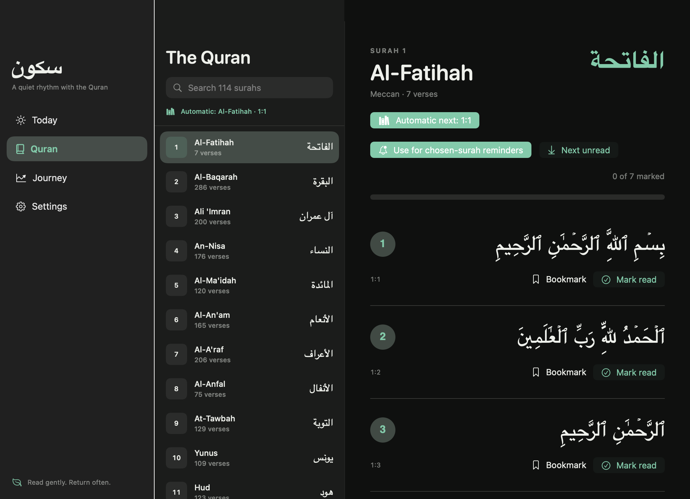
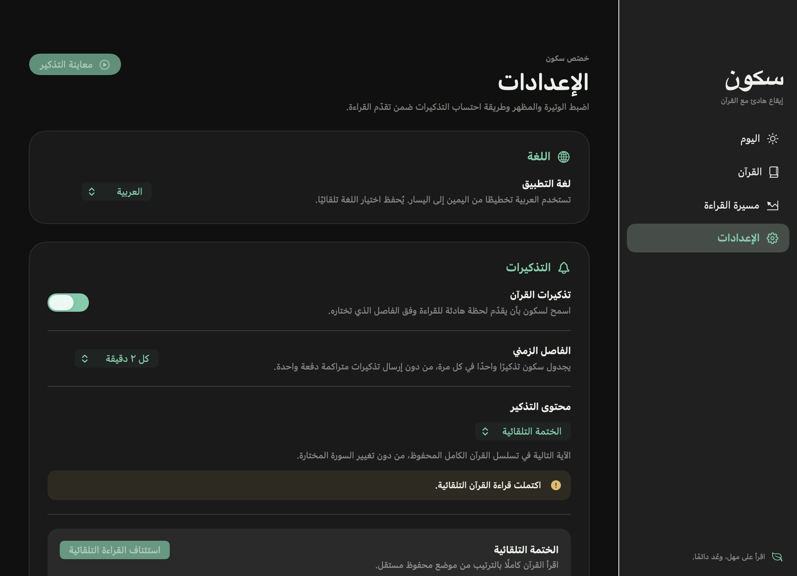

<p align="center">
  
</p>

<h1 align="center">Sukoon · سكون</h1>

<p align="center">
  <strong>A quiet rhythm with the Quran.</strong><br>
  A native macOS menu bar app for Arabic ayahs, Quranic duas, and a reading journey that remembers where you stopped.
</p>

<p align="center">
  
  
  
  
</p>

<p align="center">
  <a href="#preview">Preview</a> ·
  <a href="#getting-started">Getting started</a> ·
  <a href="#reading-modes">Reading modes</a> ·
  <a href="#development">Development</a> ·
  <a href="#quran-sources-and-licensing">Sources &amp; licensing</a>
</p>

---

## Preview

<p align="center">
  
</p>

The menu bar stays minimal: Arabic text, a surah reference, and access to the reader and settings. The popover uses a configurable auto-close delay; scheduled reminders and previews close automatically after **10 seconds**.

<p align="center">
  
</p>

<details>
<summary><strong>Arabic interface and Quran completion</strong></summary>

<p align="center">
  
</p>

<p align="center">
  
</p>

</details>

<sub>Actual native app captures on macOS 27. Reading progress in these screenshots is demonstration data.</sub>

## Features

- **Small, timed reading moments.** A reminder every two minutes by default, configurable from 30 seconds to two hours, with pause/resume controls.
- **The complete Quran, offline.** All 114 surahs and 6,236 ayahs in Arabic Uthmani text. Search by Arabic name, transliteration, or surah number, including Arabic digits.
- **Automatic Quran reading.** Move from Al-Fatihah to An-Nas, one ayah at a time, with a separately saved position.
- **Choose your own surah.** Follow a specific chapter without resetting the automatic Quran journey.
- **A full reader.** Read at your own pace, mark ayahs, save a bookmark, and resume later.
- **English and Arabic.** An immediately switchable interface with right-to-left layout in Arabic and independently selectable Quran digits.
- **Native appearance.** System, Light, or Dark theme; Jade, Gold, or Rose accents; adjustable Arabic text size.
- **Completion moments.** Surah completion feedback and a Quran completion celebration with a Quranic dua. Confetti respects Reduce Motion.

## Getting started

### Requirements

- **Prebuilt app:** an **Apple Silicon Mac (M1 or later)** running **macOS 26 or later**. The release ZIP does not support Intel Macs.
- **Building from source:** macOS 26 or later, a full **Xcode** installation with **Swift 6.2 or later**, and a compatible macOS SDK. Command Line Tools alone are not sufficient for building this project.

Verified configuration: **macOS 27, Apple Silicon, Xcode 27, Swift 6.4**. Other configurations have not been verified.

### Download and install

1. Open the [latest GitHub release](https://github.com/rayenfassatoui/Sukoon/releases/latest) and download the **macOS Apple Silicon (`arm64`) app ZIP** under **Assets**, not the automatically generated source-code archives.
2. Unzip it and move **`Sukoon.app`** into **`/Applications`**.
3. Open Sukoon. Its icon appears in the menu bar; **Xcode is not required** to run the downloaded app.

> [!IMPORTANT]
> The downloadable app is **ad-hoc signed and not notarized by Apple**. If macOS blocks its first launch as an unidentified developer, and you trust this repository and downloaded its release asset, open **System Settings → Privacy & Security → Open Anyway**, then confirm **Open**. Do not disable Gatekeeper globally.

### Build and open

Clone or download this repository, then run these commands from its root:

```sh
swift Tools/Bundle.swift
open build/Sukoon.app
```

The bundler builds a release executable, packages the offline Quran, license notices, English and Arabic resources, and app icon, then ad-hoc signs the app. It finds a full Xcode installation without changing your system-wide `xcode-select` setting. Set `DEVELOPER_DIR` if you need to select a specific Xcode installation.

You can move **`build/Sukoon.app`** into **`/Applications`**. The bundle is self-contained; it does not need the source checkout to run.

### First use

1. Open Sukoon. Use the menu bar icon to access the compact Quran view.
2. Open **Settings** from the **…** menu to choose your language, menu bar auto-close delay, reminder interval, content, and appearance.
3. Open the **Quran** reader to browse chapters, bookmark a verse, or choose a reading plan.

Closing the main window keeps Sukoon running in the menu bar. Use **Quit** to stop the app and its reminders.

## Reading modes

Choose a mode in **Settings → Reminders → Reminder content**.

| Mode | What appears | Reading-plan behavior |
| --- | --- | --- |
| **Ayahs & duas** | A mix of Quran ayahs and Quranic duas | Does not advance a reading plan; the default mode |
| **Random ayah** | A randomly selected Quran ayah | Does not advance a reading plan |
| **Quranic dua** | A complete Quran verse containing a supplication | Does not advance a reading plan |
| **Selected surah** | The next unmarked ayah in your chosen chapter | Continues in chapter order; stops when the chapter is complete |
| **Automatic Quran** | The next ayah in the full-Quran sequence | Continues across surahs from 1:1 to 114:6; stops at completion |

### Automatic Quran journey

In Settings, use the automatic reading section's **Start / Resume automatic reading** action. In Arabic, this section is **الختمة التلقائية**.

- Starts at **Al-Fatihah 1:1**, then continues through every surah in order.
- Saves its next ayah independently of your chosen-surah selection and bookmark.
- Remembers its position after quitting, restarting, sleeping the Mac, pausing reminders, or switching to another content mode.
- Resumes from that saved position when you return to automatic reading—not from the beginning.
- Stops after **An-Nas 114:6**; it does not silently loop back to Al-Fatihah.

### Your chosen surah

Open a chapter in the reader and select **Use for chosen-surah reminders**, or use **Use chosen surah** in Settings.

This mode follows the next globally unmarked ayah in that chapter. Reading marks are shared across the app, but the **automatic Quran position is separate**: choosing a surah or marking verses in the reader does not reset or skip the automatic sequence.

### What counts as progress?

> [!IMPORTANT]
> **Delivered is not the same as read.** With **Automatic delivered progress** enabled—the default—a reading-plan ayah is marked only after its real scheduled reminder panel is successfully shown. This records delivery, not proof that you read it.

Turn that setting off to require **Read & continue** in the reminder panel, or press **Return**, before advancing. If you do not confirm the ayah, it remains the next reminder. The 10-second timeout **never** acts as manual confirmation.

The reader's **Mark read** action records your manual confirmation. Previews, random ayahs, and dua reminders do not mark reading progress. Repeated marks of the same ayah are counted only once.

## Languages

Switch between **English** and **العربية** in **Settings → Language**. Your choice is saved independently of the macOS language.

Arabic uses a right-to-left workspace, localized controls, help text, menus, and completion messages. Quran ayahs remain Arabic in both interface languages. Changing language preserves reading progress, bookmarks, and reminder preferences.

Choose **Western (123)** or **Arabic (١٢٣)** digits in **Settings → Language → Ayah numbers**, independently of the interface language. This controls surah and ayah identifiers, bookmarks, and Quran references in the reader, journey, menu bar, and reminder panels. Other interface values still follow the app language.

On upgrade, the initial digit choice follows the previously saved language. Both choices are then saved separately; changing either preserves Quran progress and bookmarks.

## Appearance and reminder behavior

- **System** follows the Mac's appearance; switching back to it clears a previous Light or Dark override.
- Menu bar auto-close: **10 seconds** by default. Choose **10, 15, or 20 seconds** in **Settings → Menu bar → Auto-close after**. Your choice is saved and applies the next time you open the popover.
- Reminder intervals: **30 seconds**, or **1, 2, 5, 10, 15, 30, 60, or 120 minutes**. The default remains **2 minutes**; existing saved intervals are preserved.
- Scheduled reminders and previews use one compact, scrollable panel. A new reminder replaces the old one and starts a fresh 10-second timeout; panels never stack.
- Close a panel early with its close control or **Escape**. For longer ayahs, use the full Quran reader.
- Reminders suspend while the Mac is asleep, locked, or the screen or user session is inactive. Resuming schedules one fresh interval—there is no catch-up burst.

## Privacy and saved state

Sukoon uses **Swift, SwiftUI, and AppKit**—no web runtime, third-party Swift dependencies, account, telemetry, or runtime network requirement. Quran content is bundled with the app. Attribution links open externally only when you choose them.

Preferences and reading state are stored locally in `UserDefaults` under the app's `app.sukoon.mac` domain:

- Interface language, Quran digit style, appearance, and reminder preferences.
- Automatic Quran position and chosen surah.
- Unique ayah marks and your bookmark.

**Reset Quran progress** requires confirmation. It clears reading marks, both reading plans, and the bookmark, while preserving language, Quran digit style, appearance, and reminder preferences.

## Development

### Run and test

If your active developer directory points to Command Line Tools, select full Xcode for these commands:

```sh
DEVELOPER_DIR=/Applications/Xcode.app/Contents/Developer xcrun swift run Sukoon
DEVELOPER_DIR=/Applications/Xcode.app/Contents/Developer xcrun swift test
```

For a debug app bundle:

```sh
swift Tools/Bundle.swift --debug
open build/Sukoon.app
```

### Project layout

| Location | Responsibility |
| --- | --- |
| [`Sources/Sukoon`](Sources/Sukoon) | Native lifecycle, menu bar, floating reminders, workspace, reader, settings, journey, and celebrations |
| [`Sources/SukoonCore`](Sources/SukoonCore) | Quran models and data, localization, persisted state, reading progress, and reminder scheduling |
| [`Sources/SukoonCore/Resources`](Sources/SukoonCore/Resources) | Pinned Quran data, source notices, license, and English/Arabic string catalogs |
| [`Tests/SukoonCoreTests`](Tests/SukoonCoreTests) | Dataset integrity, acknowledgement rules, sequence boundaries, persistence, reset, and scheduling tests |
| [`Tools/Bundle.swift`](Tools/Bundle.swift) | Build, resource packaging, icon generation, and local signing |

For bug reports, include the macOS version, interface language, reading mode, and steps to reproduce. For build problems, also include the Xcode and Swift versions.

## Quran sources and licensing

The bundled text is the **unchanged, pinned Quran JSON 3.1.2 dataset** by **Risan Bagja Pradana**.

- [Dataset project and pinned version](https://github.com/risan/quran-json/tree/v3.1.2)
- [Pinned JSON download](https://cdn.jsdelivr.net/npm/quran-json@3.1.2/dist/quran.json)
- **Arabic Uthmani text:** credited by the dataset to [The Noble Qur'an Encyclopedia](https://quranenc.com/en/home).
- **English surah transliteration:** credited to [Tanzil](https://tanzil.net/trans/en.transliteration). Sukoon does not display verse transliterations.

The dataset is redistributed under **[Creative Commons Attribution–ShareAlike 4.0 International](https://creativecommons.org/licenses/by-sa/4.0/)**. The complete [license text](Sources/SukoonCore/Resources/QURAN-LICENSE.txt) and [attribution notice](Sources/SukoonCore/Resources/QURAN-NOTICE.txt) are included in the source and app bundle. Source links are also available in Settings.

<details>
<summary><strong>Verify the bundled dataset</strong></summary>

From the repository root:

```sh
shasum -a 256 Sources/SukoonCore/Resources/quran.json
```

Expected SHA-256:

```text
d8a8adff387f60ce3ff7dbe3238dd9b27120bfe29d8fcb07ad2e89cad37cefd4
```

</details>

Dua reminders use complete Quran verses with their original surah and ayah references—not generated or substituted text. The completion dua is **Quran 2:127**; it is not presented as a specially prescribed khatm supplication.

**Application code:** no application-code license is currently declared in this repository. The dataset's CC BY-SA 4.0 license applies to the dataset and should not be treated as the application's license.
